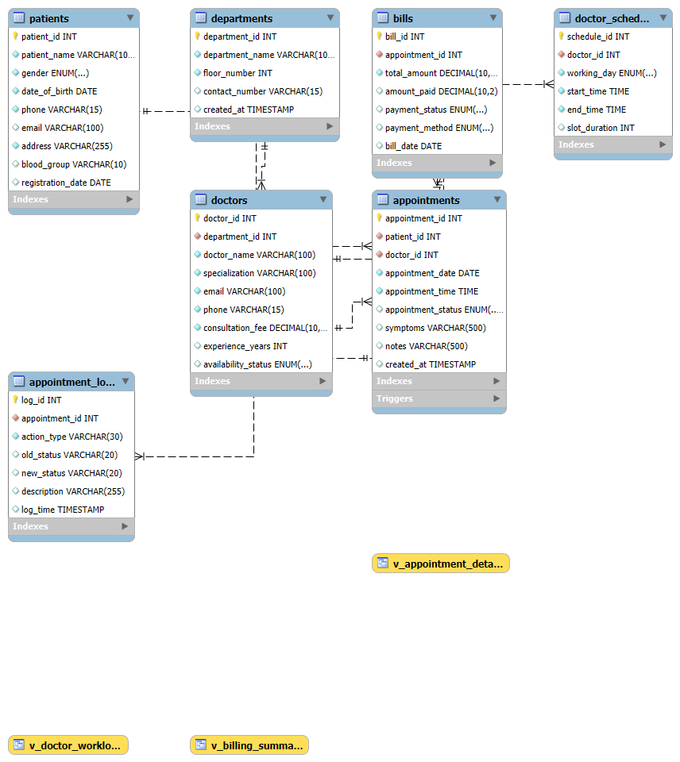

# Hospital Appointment Management System

A relational database project built with **MySQL 8.0** to manage hospital departments, doctors, doctor schedules, patients, appointments, billing, and appointment activity logs.

## Project Overview

The Hospital Appointment Management System stores patient and doctor information, organizes doctors by department, maintains doctor working schedules, records patient appointments, tracks payments, and keeps an audit trail when appointments are created or their status changes.

The database is named `hospital_management_system`.

## ER Diagram

The following ER diagram represents the database tables, their key fields, and the relationships between them.



## Database Tables

| Table | Purpose | Primary key |
|---|---|---|
| `departments` | Stores hospital department details, floor number, and contact number. | `department_id` |
| `patients` | Stores patient personal and registration details. | `patient_id` |
| `doctors` | Stores doctor details, specialization, consultation fee, experience, and department. | `doctor_id` |
| `doctor_schedule` | Stores each doctor's working day, start/end time, and appointment slot duration. | `schedule_id` |
| `appointments` | Stores patient-doctor bookings, date/time, symptoms, notes, and appointment status. | `appointment_id` |
| `bills` | Stores the bill and payment information for an appointment. | `bill_id` |
| `appointment_logs` | Maintains a history of appointment creation and status changes. | `log_id` |

The project also defines three views: `v_appointment_details`, `v_doctor_workload`, and `v_billing_summary`.

## ER Model and Relationships

- **Departments → Doctors:** One department can have multiple doctors. Each doctor belongs to one department (`doctors.department_id`).
- **Doctors → Doctor Schedule:** A doctor can have schedule records. Each schedule belongs to one doctor (`doctor_schedule.doctor_id`). The schema enforces one schedule row per doctor per working day.
- **Patients → Appointments:** One patient can have multiple appointments. Each appointment belongs to one patient (`appointments.patient_id`).
- **Doctors → Appointments:** One doctor can handle multiple appointments. Each appointment is assigned to one doctor (`appointments.doctor_id`).
- **Appointments → Bills:** An appointment can have at most one bill in this schema because `bills.appointment_id` is both a foreign key and `UNIQUE`.
- **Appointments → Appointment Logs:** One appointment can have multiple log entries. Each log entry refers to one appointment (`appointment_logs.appointment_id`).

### Key Constraints

- Primary keys uniquely identify records in each table.
- Foreign keys maintain relationships between related tables.
- Unique constraints are used for values such as department names, patient phone numbers, doctor email/phone numbers, and bill appointment IDs.
- `CHECK` constraints validate values such as floor number, consultation fee, experience, schedule times, slot duration, and payment amounts.
- `ENUM` columns restrict values for gender, appointment status, working day, payment status, payment method, and doctor availability.

## Main Features

- Patient registration and patient record management.
- Department and doctor management.
- Doctor schedule management.
- Appointment booking and status tracking.
- Duplicate active doctor-slot prevention using a `BEFORE INSERT` trigger.
- Automatic appointment activity logging using `AFTER INSERT` and `AFTER UPDATE` triggers.
- Billing and payment tracking, including pending, partial, and paid states.
- Reporting using joins, aggregate functions, `GROUP BY`, and `HAVING`.
- Reusable reporting views.
- Transaction examples demonstrating `COMMIT`, `SAVEPOINT`, and `ROLLBACK`.

## Triggers

| Trigger | Event | Purpose |
|---|---|---|
| `trg_prevent_duplicate_appointment` | `BEFORE INSERT` on `appointments` | Rejects a new appointment when the same doctor already has a non-cancelled appointment at the same date and time. |
| `trg_log_new_appointment` | `AFTER INSERT` on `appointments` | Adds a log entry when a new appointment is created. |
| `trg_log_status_update` | `AFTER UPDATE` on `appointments` | Adds a log entry when the appointment status changes. |

## Views

| View | Purpose |
|---|---|
| `v_appointment_details` | Provides a combined appointment detail/report view. |
| `v_doctor_workload` | Provides doctor appointment workload information. |
| `v_billing_summary` | Provides a billing summary. |

## SQL Concepts Demonstrated

- `CREATE DATABASE` and `CREATE TABLE`
- Primary keys, foreign keys, `UNIQUE`, `CHECK`, and `ENUM`
- `INSERT`, `SELECT`, `UPDATE`, and `DELETE`
- Filtering with `WHERE`, `LIKE`, `BETWEEN`, and `IN`
- Sorting with `ORDER BY` and limiting results with `LIMIT`
- `INNER JOIN` and `LEFT JOIN`
- Aggregate functions such as `COUNT()` and `SUM()`
- `GROUP BY` and `HAVING`
- Views
- Triggers and `SIGNAL SQLSTATE`
- Transactions using `START TRANSACTION`, `COMMIT`, `SAVEPOINT`, and `ROLLBACK`

## Setup

### Requirements

- MySQL Server 8.0 or later
- MySQL Shell 8.0 or MySQL Workbench

### Create and select the database

Open MySQL Shell, switch to SQL mode, connect to your local MySQL server, and run:

```sql
\sql
\connect root@localhost:3306

CREATE DATABASE IF NOT EXISTS hospital_management_system;
USE hospital_management_system;
```

Then execute the table creation, sample-data, trigger, view, and query sections from the SQL project script in the order provided.

> **Note:** The supplied `.sql` upload appears to be a MySQL Shell session transcript containing prompts and query output as well as SQL statements. It may need to be cleaned into a plain SQL script before using MySQL Workbench's **Run SQL Script** or executing it as a file. In MySQL Shell, run the SQL statements themselves (not the displayed prompts or result tables).

## Useful Verification Commands

```sql
USE hospital_management_system;

SHOW TABLES;

SELECT COUNT(*) AS total_patients
FROM patients;

SELECT COUNT(*) AS total_doctors
FROM doctors;

SELECT COUNT(*) AS total_appointments
FROM appointments;

SELECT * FROM v_appointment_details;
SELECT * FROM v_doctor_workload;
SELECT * FROM v_billing_summary;

SHOW TRIGGERS;
```

## Sample Queries

### 1. List appointments with patient and doctor names

```sql
SELECT
    p.patient_name,
    d.doctor_name,
    a.appointment_date,
    a.appointment_time,
    a.appointment_status
FROM appointments AS a
JOIN patients AS p
    ON a.patient_id = p.patient_id
JOIN doctors AS d
    ON a.doctor_id = d.doctor_id
ORDER BY a.appointment_date, a.appointment_time;
```

### 2. Display doctors with their departments

```sql
SELECT
    d.doctor_name,
    d.specialization,
    dep.department_name
FROM doctors AS d
JOIN departments AS dep
    ON d.department_id = dep.department_id;
```

### 3. Count appointments handled by each doctor

```sql
SELECT
    d.doctor_name,
    COUNT(a.appointment_id) AS total_appointments
FROM doctors AS d
LEFT JOIN appointments AS a
    ON d.doctor_id = a.doctor_id
GROUP BY d.doctor_id, d.doctor_name;
```

### 4. Calculate revenue collected by department

```sql
SELECT
    dep.department_name,
    SUM(b.amount_paid) AS revenue_collected
FROM departments AS dep
JOIN doctors AS d
    ON dep.department_id = d.department_id
JOIN appointments AS a
    ON d.doctor_id = a.doctor_id
JOIN bills AS b
    ON a.appointment_id = b.appointment_id
GROUP BY dep.department_id, dep.department_name
ORDER BY revenue_collected DESC;
```

### 5. Find outstanding bill balances

```sql
SELECT
    bill_id,
    total_amount,
    amount_paid,
    total_amount - amount_paid AS due_amount
FROM bills
WHERE amount_paid < total_amount;
```

### 6. Find appointments for a particular date

```sql
SELECT
    appointment_id,
    patient_id,
    doctor_id,
    appointment_date,
    appointment_time,
    appointment_status
FROM appointments
WHERE appointment_date = '2026-11-24'
ORDER BY appointment_time;
```

## Sample Data

The supplied project transcript shows sample records inserted into the main tables, including departments, patients, doctors, doctor schedules, appointments, and bills. It also demonstrates appointment log entries created by triggers.

## Project Structure

Keep the README and ER diagram in the same project folder so that the image displays correctly on GitHub:

```text
Hospital-Appointment-Management/
├── README.md
├── ER_Diagram.png
└── hospital_management.sql
```

## Future Enhancements

- Add user login and role-based access for administrators, doctors, and reception staff.
- Add stronger validation to ensure appointments fall within a doctor's configured working schedule.
- Add automated bill generation when an appointment is confirmed.
- Add indexes and performance testing for larger datasets.
- Build a web interface or dashboard for appointment and billing reports.

---

**Project:** Hospital Appointment Management System  
**Database:** MySQL  
**Database name:** `hospital_management_system`
