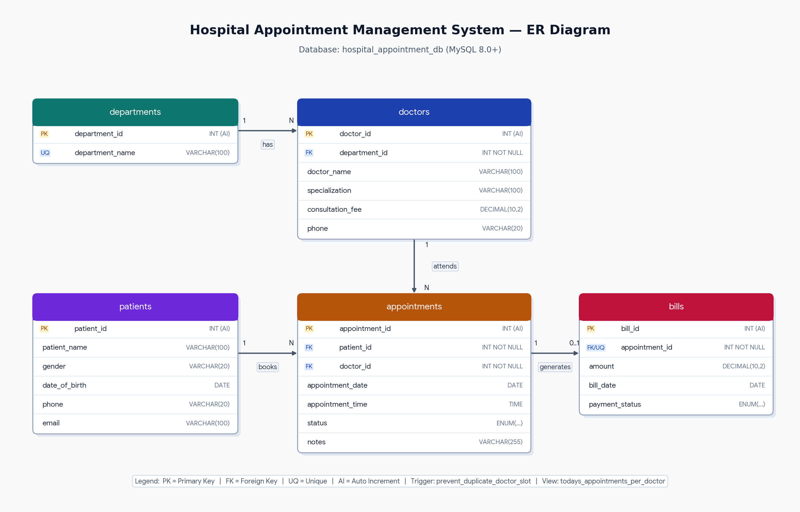
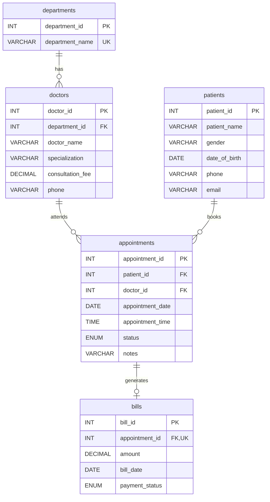

# Hospital Appointment Management System

A MySQL 8.0+ database project for managing hospital departments, doctors, patients, appointments, and bills. The project demonstrates relational database design, constraints, a trigger, a view, a transaction, reporting queries, and optional CSV import/export.

## ER Diagram





## Database Relationships

- **Departments → Doctors (1:N):** A department can have multiple doctors.
- **Patients → Appointments (1:N):** A patient can book multiple appointments.
- **Doctors → Appointments (1:N):** A doctor can attend multiple appointments.
- **Appointments → Bills (1:0..1):** An appointment can have at most one bill. `appointment_id` in `bills` is unique.

## Project Files

| File | Description |
|---|---|
| `hospital_appointment_management.sql` | Main SQL script for schema, trigger, view, sample data, transaction and reports |
| `doctors.csv` | Sample CSV file for doctor import |
| `er_diagram.png` | ER diagram image |
| `README.md` | Project documentation |

## Features

- Five tables: `departments`, `patients`, `doctors`, `appointments`, and `bills`.
- Primary keys, foreign keys, unique constraints, and check constraints.
- Trigger `prevent_duplicate_doctor_slot` prevents a doctor from having two non-cancelled appointments at the same date and time.
- View `todays_appointments_per_doctor` lists today's appointments with patient, doctor, and department details.
- Transaction to confirm an appointment and create its bill as a combined operation.
- Report queries for patient counts by department, doctor workload, and monthly revenue.
- Optional doctor CSV import and bills CSV export.

## How to Run

1. Install and open MySQL 8.0+ (MySQL Shell or MySQL Workbench).
2. Open `hospital_appointment_management.sql`.
3. Execute the script from top to bottom in a fresh database setup.
4. The script creates and selects `hospital_appointment_db`, creates the tables, trigger and view, inserts sample data, and runs example queries and transaction.
5. To test the duplicate-slot trigger, uncomment and run the test INSERT separately. It should raise an error for an already occupied slot.
6. CSV import/export sections are commented out. Follow the instructions in the SQL file and adjust paths/settings before running them.

> **Note:** The main script is intended for a fresh database. Running it repeatedly may duplicate sample rows. For CSV import, department IDs must exist. `LOCAL INFILE` may require client/server configuration. `SELECT ... INTO OUTFILE` is subject to the MySQL server's `secure_file_priv`; exporting the result grid from Workbench is an alternative.

## Sample Queries

### 1. Today's appointments

```sql
SELECT *
FROM todays_appointments_per_doctor
ORDER BY doctor_name, appointment_time;
```

### 2. Patients per department

Counts distinct patients with non-cancelled appointments in each department.

```sql
SELECT
    dep.department_name,
    COUNT(DISTINCT a.patient_id) AS total_patients
FROM departments AS dep
LEFT JOIN doctors AS d
    ON dep.department_id = d.department_id
LEFT JOIN appointments AS a
    ON d.doctor_id = a.doctor_id
   AND a.status <> 'Cancelled'
GROUP BY dep.department_id, dep.department_name
ORDER BY dep.department_name;
```

### 3. Doctor workload

Counts non-cancelled appointments for each doctor.

```sql
SELECT
    d.doctor_id,
    d.doctor_name,
    dep.department_name,
    COUNT(a.appointment_id) AS total_appointments
FROM doctors AS d
JOIN departments AS dep ON d.department_id = dep.department_id
LEFT JOIN appointments AS a
    ON d.doctor_id = a.doctor_id
   AND a.status <> 'Cancelled'
GROUP BY d.doctor_id, d.doctor_name, dep.department_name
ORDER BY total_appointments DESC, d.doctor_name;
```

### 4. Monthly revenue

Shows total billed and total collected (paid bills only), grouped by month.

```sql
SELECT
    DATE_FORMAT(bill_date, '%Y-%m') AS revenue_month,
    SUM(amount) AS total_billed,
    SUM(CASE WHEN payment_status = 'Paid' THEN amount ELSE 0 END) AS total_collected
FROM bills
GROUP BY YEAR(bill_date), MONTH(bill_date), DATE_FORMAT(bill_date, '%Y-%m')
ORDER BY YEAR(bill_date), MONTH(bill_date);
```

### 5. Appointment and bill details

```sql
SELECT
    a.appointment_id,
    p.patient_name,
    d.doctor_name,
    a.status AS appointment_status,
    b.amount,
    b.bill_date,
    b.payment_status
FROM appointments AS a
JOIN patients AS p ON a.patient_id = p.patient_id
JOIN doctors AS d ON a.doctor_id = d.doctor_id
LEFT JOIN bills AS b ON a.appointment_id = b.appointment_id
ORDER BY a.appointment_id;
```

## Trigger Test (Optional)

The following test is expected to fail if doctor 1 already has a non-cancelled appointment today at `09:00:00`.

```sql
INSERT INTO appointments
    (patient_id, doctor_id, appointment_date, appointment_time)
VALUES
    (2, 1, CURDATE(), '09:00:00');
```

## Transaction Used in the Project

The SQL script includes a transaction that updates a booked appointment to `Confirmed` and creates a pending bill using the doctor's consultation fee, then commits the changes together.

## Skills Demonstrated

**MySQL · SQL Queries · Database Design · ER Modeling · Constraints · Joins · Aggregation · Views · Triggers · Transactions · Reporting · CSV Import/Export**
